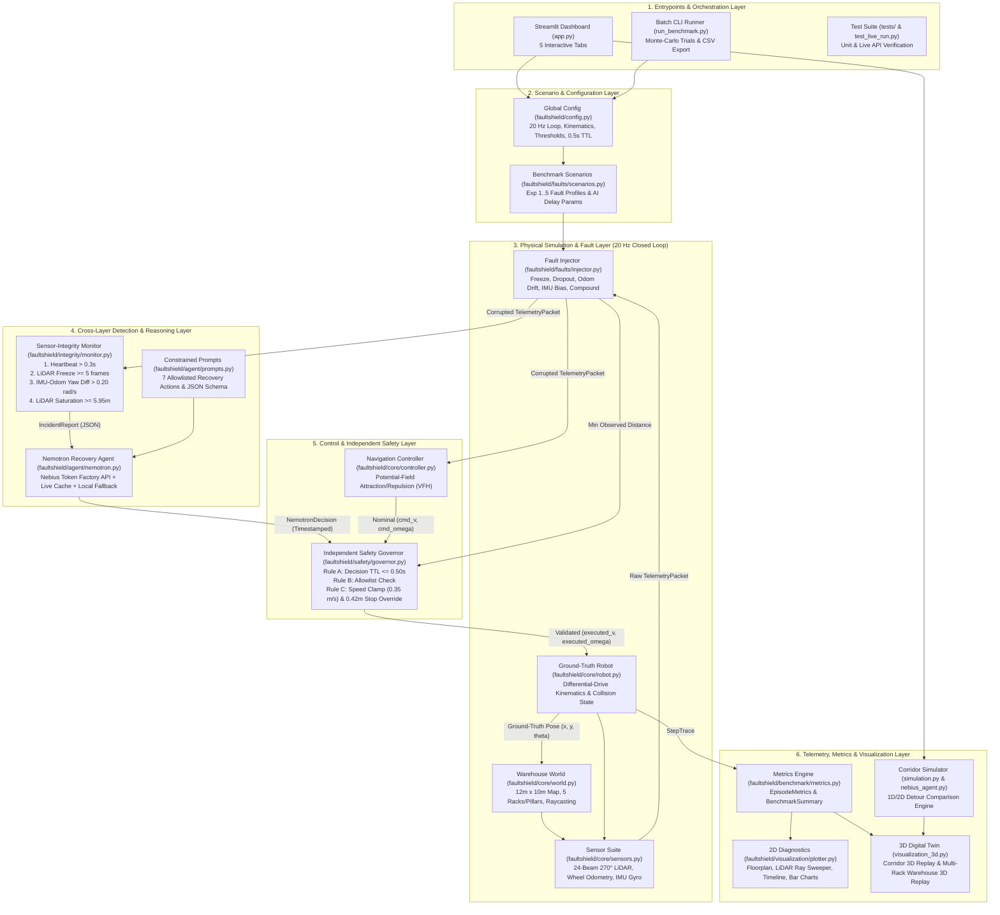
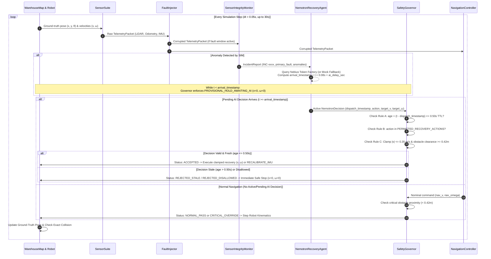
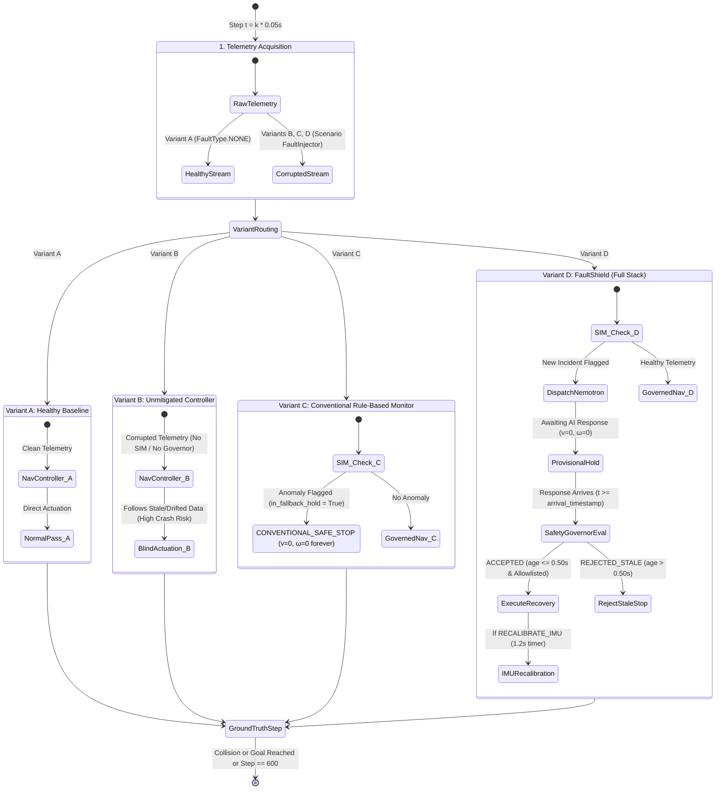

# 🛡️ FaultShield: Cross-Layer Reliability Benchmark & Recovery Agent

> **A Cross-Layer Reliability Benchmark and Recovery Agent for Simulated Autonomous Mobile Robots**  
> *Physical AI Track — NVIDIA Nemotron — Nebius Token Factory — Zero Physical Hardware Required*

[](https://python.org)
[](https://tokenfactory.nebius.ai/)
[](https://build.nvidia.com)
[](https://streamlit.io)
[](https://plotly.com/python/)
[](https://opensource.org/licenses/MIT)

🔗 **Quick Links:**
- 📊 **[Interactive HTML Workflow Architecture (Full Visual Diagrams)](https://htmlpreview.github.io/?https://github.com/WAQASCHANNA/FaultShield/blob/main/WORKFLOW_ARCHITECTURE.html)**
- 📄 **[Workflow Architecture & Project Review Document (`WORKFLOW_ARCHITECTURE.md`)](WORKFLOW_ARCHITECTURE.md)**
- 📈 **[Pre-computed Benchmark Summary CSV (`results/benchmark_summary.csv`)](results/benchmark_summary.csv)**
- 🎥 **[Recorded 3D & Full Dashboard Demo Videos (`results/`)](results/)**

---

## 📖 Table of Contents

1. [The Research Opportunity: Why FaultShield?](#-1-the-research-opportunity-why-faultshield)
2. [High-Level End-to-End Workflow Architecture](#-2-high-level-end-to-end-workflow-architecture)
3. [Runtime Execution & Recovery Sequence (`20 Hz` Loop)](#-3-runtime-execution--recovery-sequence-20-hz-loop)
4. [Four-Variant Comparative Evaluation Model & State Machine](#-4-four-variant-comparative-evaluation-model--state-machine)
5. [Deep-Dive into Core Subsystems](#-5-deep-dive-into-core-subsystems)
6. [The Five Controlled Benchmark Experiments](#-6-the-five-controlled-benchmark-experiments)
7. [Quantitative Benchmark Results](#-7-quantitative-benchmark-results)
8. [Complete Repository Structure & Module Inventory](#-8-complete-repository-structure--module-inventory)
9. [Quickstart, Installation & Execution Guide](#-9-quickstart-installation--execution-guide)
10. [Key Reliability Metrics Tracked](#-10-key-reliability-metrics-tracked)
11. [License](#-11-license)

---

## 🎯 1. The Research Opportunity: Why FaultShield?

Recent literature establishes that robot failure diagnosis (**VLA-FixBench**, ICML 2026), recovery benchmarks (**LIBERO-Recover**, 2026), and latency-aware controllers (**LARA**, 2026) are active research domains. Furthermore, existing patents (NVIDIA `US20260091502A1`, Sony `US20250199539A1`, ABB `CN116368444B`) address high-level failure explanations and generic uncertainty estimation.

### The Unresolved Cross-Layer Gap

Rather than claiming a generic AI failure detector, **FaultShield addresses the critical cross-layer interaction between perception corruption and inference latency:**

> *"When an embodied AI agent receives delayed, corrupted, or contradictory sensor data—and its own cloud reasoning pipeline is subject to network latency or packet jitter—can it detect when **not** to act, enter a provisional safe state, and recover reliably without executing stale AI commands?"*

| Existing Benchmark / Prior Art | Scope Addressed | Unaddressed Cross-Layer Gap Solved by FaultShield |
| :--- | :--- | :--- |
| **VLA-FixBench (ICML 2026)** | VLM diagnosis of tabletop manipulation failures | Does not evaluate mobile robot kinematics under corrupted/frozen range & IMU telemetry |
| **LIBERO-Recover (2026)** | Task-level policy retries and behavioral adaptation | Assumes accurate, uncorrupted state estimation and zero sensor freeze |
| **LARA (2026)** | Asynchronous inference delay compensation | Does not couple remote LLM inference delay with simultaneous onboard sensor faults |
| **Industrial Patents** | High-level anomaly reporting & generic uncertainty | Lacks a deterministic **Time-To-Live (TTL) Safety Governor** paired with allowlisted LLM recovery |

---

## 🏗️ 2. High-Level End-to-End Workflow Architecture

FaultShield is architected around a **6-layer physical-AI control loop** with an **independent fail-safe safety governor** and a **dual-engine visualization pipeline** (Multi-Rack Warehouse 2D/3D engine + Corridor 3D detour replay engine).

### Mermaid System Architecture Flowchart



### Layered Control Pipeline Summary

```text
                       ┌──────────────────────────────────────────────┐
                       │   2D Warehouse World (Ground Truth Scoring)  │
                       └──────────────────────┬───────────────────────┘
                                              │ (x, y, θ)
                                              ▼
                       ┌──────────────────────────────────────────────┐
                       │  Sensor Suite (2D LiDAR, Odometry, IMU Gyro) │
                       └──────────────────────┬───────────────────────┘
                                              │ Raw Telemetry
                                              ▼
                       ┌──────────────────────────────────────────────┐
                       │     Configurable Fault Injection Engine      │
                       │ (Freeze, Range Dropout, Odom Drift, IMU Bias)│
                       └──────────────────────┬───────────────────────┘
                                              │ Corrupted Telemetry Stream
                                              ▼
                       ┌──────────────────────────────────────────────┐
                       │        Sensor-Integrity Monitor (SIM)        │
                       │ (Freshness check, Variance, Cross-modal test)│
                       └──────────────────────┬───────────────────────┘
                                              │ Incident Report (JSON)
                                              ▼
                       ┌──────────────────────────────────────────────┐
                       │     NVIDIA Nemotron Recovery Agent           │
                       │      (via Nebius Token Factory API)          │
                       │  - Recommends strictly allowlisted action    │
                       └──────────────────────┬───────────────────────┘
                                              │ Action Dispatch (timestamped)
                                              ▼
                       ┌──────────────────────────────────────────────┐
                       │         Independent Safety Governor          │
                       │  - TTL Check (< 0.50s; rejects stale AI recs)│
                       │  - Kinematic Allowlist & Speed Clamping      │
                       │  - Critical obstacle proximity override      │
                       └──────────────────────┬───────────────────────┘
                                              │ Validated Velocity (v, ω)
                                              ▼
                       ┌──────────────────────────────────────────────┐
                       │   Robot Kinematic Actuation & Safe Recovery  │
                       └──────────────────────────────────────────────┘
```

---

## 🔄 3. Runtime Execution & Recovery Sequence (`20 Hz` Loop)

During each simulation episode (`max_steps = 600`, `dt = 0.05s`, up to `30.0s`), [`BenchmarkRunner.run_episode`](faultshield/benchmark/runner.py) orchestrates synchronous 20 Hz physical kinematics alongside asynchronous/delayed remote inference:



---

## ⚖️ 4. Four-Variant Comparative Evaluation Model & State Machine

FaultShield tests every scenario across **4 system variants** under identical random seeds to rigorously isolate whether LLM-based recovery and TTL governance add genuine safety and operational value:

- **Variant A (`Variant_A` — Healthy Baseline):** Standard potential-field controller with zero injected faults (`FaultType.NONE`). Establishes nominal trajectory and travel metrics.
- **Variant B (`Variant_B` — Unmitigated Controller):** Standard controller receiving corrupted telemetry without SIM or Safety Governor. Demonstrates how frozen LiDAR or compound faults cause physical collisions.
- **Variant C (`Variant_C` — Conventional Monitor + Fixed Fallback):** Deterministic rule-based monitor (`SensorIntegrityMonitor`) triggers an unconditional permanent halt (`CONVENTIONAL_SAFE_STOP`) upon the first anomaly (non-LLM baseline).
- **Variant D (`Variant_D` — FaultShield System):** Full stack combining `SensorIntegrityMonitor` + `NemotronRecoveryAgent` (via Nebius Token Factory) + `SafetyGovernor` (`0.50s` TTL guard, allowlist validation, and kinematic clamping).



---

## 🔧 5. Deep-Dive into Core Subsystems

### 5.1. 2D Warehouse World & Differential-Drive Robot (`faultshield/core/`)
- **Warehouse Geometry ([`world.py`](faultshield/core/world.py)):** A $12.0\text{ m} \times 10.0\text{ m}$ enclosed logistics floor containing 5 axis-aligned rectangular obstacles:
  - Aisle 1 Storage Racks: `Rack_A1` at `(2.5, 1.5, w=1.2, h=3.0)` and `Rack_A2` at `(2.5, 5.5, w=1.2, h=3.0)`
  - Central Loading Pillar: `Pillar_Center` at `(5.5, 4.0, w=1.0, h=2.0)`
  - Aisle 2 Storage Racks: `Rack_B1` at `(8.0, 1.5, w=1.2, h=3.0)` and `Rack_B2` at `(8.0, 5.5, w=1.2, h=3.0)`
- **Robot Kinematics ([`robot.py`](faultshield/core/robot.py)):** Circular chassis ($r = 0.35\text{ m}$) stepped at $20\text{ Hz}$ (`SIMULATION_DT = 0.05s`) with midpoint Euler integration and physical acceleration clamping:
  - $|v| \le 1.0\text{ m/s}$, $|\omega| \le 1.5\text{ rad/s}$
  - $|\dot{v}| \le 2.0\text{ m/s}^2$, $|\dot{\omega}| \le 3.0\text{ rad/s}^2$
- **Multi-Modal Sensor Suite ([`sensors.py`](faultshield/core/sensors.py)):**
  - **2D LiDAR:** 24 beams spanning a $270^\circ$ field-of-view, range $[0.1\text{ m}, 6.0\text{ m}]$, Gaussian noise $\sigma = 0.02\text{ m}$.
  - **Wheel Odometry:** Dead-reckoning pose integration with stochastic wheel slip ($\sigma_{\text{slip}} = 0.01$) and encoder noise ($\sigma_{\text{odom}} = 0.01\text{ m}$).
  - **IMU Gyro & Accelerometer:** Measures angular yaw rate $\omega_{\text{IMU}}$ with persistent gyro bias ($\sigma_{\text{bias}} = 0.005\text{ rad/s}$) and linear acceleration noise ($\sigma_{\text{accel}} = 0.03\text{ m/s}^2$).

### 5.2. Configurable Fault Injection Engine (`faultshield/faults/injector.py`)
Supports 6 distinct fault modes injected over a configurable time window $[t_{\text{start}}, t_{\text{start}} + t_{\text{duration}}]$ without mutating ground-truth physics:
1. `LIDAR_FROZEN`: Locks the LiDAR buffer to the last healthy scan frame (stale timestamp and static range array).
2. `LIDAR_DROPOUT`: Forces all 24 LiDAR beams to saturate at max range ($6.0\text{ m}$), blinding the controller to nearby obstacles.
3. `ODOMETRY_DRIFT`: Injects cumulative heading drift ($0.25 \times \text{magnitude}\text{ rad/s}$) and linear velocity bias ($0.40 \times \text{magnitude}\text{ m/s}$).
4. `IMU_BIAS`: Injects acute gyroscope yaw-rate bias ($+0.55 \times \text{magnitude}\text{ rad/s}$).
5. `AI_DECISION_DELAY`: Couples sensor dropout with a configurable cloud reasoning delay (`ai_delay_sec`, e.g., $2.2\text{ s}$).
6. `COMPOUND`: Simultaneously activates `LIDAR_FROZEN` + `ODOMETRY_DRIFT` + `IMU_BIAS` + inference latency.

### 5.3. Sensor-Integrity Monitor — SIM (`faultshield/integrity/monitor.py`)
Executes 4 deterministic mathematical checks at every $20\text{ Hz}$ tick:
1. **Heartbeat / Temporal Freshness Check:** Flags `STALE_STREAM_LATENCY` if `current_sim_time - telemetry.timestamp > 0.30s`.
2. **Frozen LiDAR Frame Detection:** Tracks a rolling 10-frame history; flags `LIDAR_FROZEN_FRAME` if $\max_i |r_t[i] - r_{t-1}[i]| < 10^{-4}$ for $\ge 5$ consecutive steps.
3. **Cross-Sensor Kinematic Consistency:** Compares IMU yaw rate against wheel odometry angular velocity; flags `IMU_ODOMETRY_DISCREPANCY` if $|\omega_{\text{IMU}} - \omega_{\text{odom}}| > 0.20\text{ rad/s}$ ($\approx 11.5^\circ/\text{s}$).
4. **Range Blackout Saturation Check:** Flags `LIDAR_BLIND_DROPOUT` if all 24 LiDAR beams report $\ge 5.95\text{ m}$ inside the enclosed warehouse.

When any check triggers, SIM packages a structured [`IncidentReport`](faultshield/integrity/monitor.py) (`INC-xxxx`, `primary_fault`, `risk_level`, `perceived_robot_state`, and anomaly breakdown).

### 5.4. NVIDIA Nemotron Recovery Agent (`faultshield/agent/`)
- **Nebius Token Factory Integration ([`nemotron.py`](faultshield/agent/nemotron.py)):** Connects via the OpenAI-compatible client to `https://api.tokenfactory.nebius.com/v1/` using `nvidia/nemotron-3-super-120b-a12b` (also supporting `Nemotron-3-Ultra-550b-a55b`, `NVIDIA-Nemotron-3-Nano-30B-A3B`, and `Nemotron-3_5-Lightning` in the UI).
- **Constrained Action Allowlist ([`prompts.py`](faultshield/agent/prompts.py)):** Instructs the model to diagnose the telemetry root cause and output strict JSON selecting **only** from 7 permitted recovery actions:
  - `SAFE_STOP_AND_HOLD`
  - `REVERSE_SLOWLY`
  - `ROTATE_IN_PLACE_SCAN`
  - `SWITCH_TO_CONSERVATIVE_CONTOURING`
  - `FALLBACK_WALL_FOLLOW`
  - `SAFE_STOP_AND_REPLAN`
  - `RECALIBRATE_IMU`
- **Deterministic Offline Fallback:** When `NEBIUS_API_KEY` is omitted or offline mode is selected, `_generate_mock_decision` provides a deterministic local recovery policy so the entire benchmark suite runs reproducibly with zero network dependency.

### 5.5. Independent Safety Governor (`faultshield/safety/governor.py`)
Acts as the last line of defense before robot actuation:
- **Rule A — Decision Time-To-Live (`GOVERNOR_MAX_DECISION_TTL_SEC = 0.50s`):** Computes `age = current_sim_time - ai_decision.dispatch_timestamp`. Any recommendation with `age > 0.50s` is immediately blocked (`REJECTED_STALE`) and overridden with a zero-velocity safe stop (`v = 0.0, ω = 0.0`).
- **Rule B — Allowlist Enforcement:** Rejects any action not in `PERMITTED_RECOVERY_ACTIONS` (`REJECTED_DISALLOWED`).
- **Rule C — Kinematic Envelope Clamping & Proximity Guard:** Clamps recovery linear speed to $[-0.35, 0.35]\text{ m/s}$, angular speed to $[-1.0, 1.0]\text{ rad/s}$, and overrides forward velocity to $0.0\text{ m/s}$ if `min_observed_dist < 0.42m` (`CRITICAL_OVERRIDE`).

### 5.6. Dual Simulation & 3D Digital Twin Replay (`visualization_3d.py` & `simulation.py`)
The Streamlit dashboard (`app.py`) provides two interactive 3D digital-twin replay modes built with Plotly `Mesh3d` (featuring 3D robot chassis, dual cylindrical wheels, floor grid, and Play/Pause/Scrubber animation controls):
1. **Corridor Obstacle 3D Replay ([`build_3d_replay`](visualization_3d.py)):** Compares Baseline vs. FaultShield trajectories along a 10m corridor with a central obstacle (`simulation.py` & `nebius_agent.py`).
2. **Multi-Rack Warehouse 3D Digital Twin ([`build_3d_warehouse_replay`](visualization_3d.py)):** Replays the full 2D kinematic trajectories (`Variant_B` vs. `Variant_D`) inside the 3D multi-rack warehouse layout.

---

## 🧪 6. The Five Controlled Benchmark Experiments

Defined in [`faultshield/faults/scenarios.py`](faultshield/faults/scenarios.py):

| Experiment ID | Scenario Name | Fault Type | Window ($t_{\text{start}}$, Duration) | Sim AI Delay | Primary Failure Mode Tested |
| :--- | :--- | :--- | :--- | :--- | :--- |
| **`exp1_healthy`** | **Healthy sensors** | `NONE` | `0.0s`, `0.0s` | `0.05s` | Zero-fault baseline navigation and travel envelope |
| **`exp2_frozen_lidar`** | **Stale LiDAR** | `LIDAR_FROZEN` | `2.5s`, `8.0s` | `0.10s` | Blind collision with aisle racks due to frozen LiDAR buffer |
| **`exp3_contradictory_telemetry`** | **Experiment 3: Contradictory Measurements** | `IMU_BIAS` | `2.0s`, `7.0s` | `0.10s` | Cross-sensor kinematic divergence (IMU gyro drift vs. wheel encoders) |
| **`exp4_delayed_ai`** | **Experiment 4: Delayed AI Decision** | `AI_DECISION_DELAY` | `2.0s`, `10.0s` | `2.20s` | Safety Governor rejection of stale cloud AI recommendations (`> 0.50s` TTL) |
| **`exp5_compound_faults`** | **Experiment 5: Compound Cross-Layer Faults** | `COMPOUND` | `2.0s`, `9.0s` | `1.80s` | Simultaneous frozen LiDAR, odometry slip drift, IMU bias, and inference delay |

---

## 📊 7. Quantitative Benchmark Results

Summary metrics generated by `python run_benchmark.py` (stored in [`results/benchmark_summary.csv`](results/benchmark_summary.csv)):

| Scenario | Variant | Collision Rate (%) | Recovery Rate (%) | Mean Duration (s) | Mean Path Length (m) | Stale Rejections Blocked | Stale Acceptance (%) |
| :--- | :--- | :---: | :---: | :---: | :---: | :---: | :---: |
| **`exp1_healthy`** | `Variant_A` / `B` / `C` / `D` | **0.0%** | **100.0%** | 30.0s | 8.74m | 0 | **0.0%** |
| **`exp2_frozen_lidar`** | `Variant_B` (Unmitigated) | **100.0%** 💥 | 0.0% | 4.4s | 2.48m | 0 | 0.0% |
| **`exp2_frozen_lidar`** | `Variant_C` (Fixed Stop) | **0.0%** ✅ | 100.0% | 30.0s | 1.06m | 0 | 0.0% |
| **`exp2_frozen_lidar`** | `Variant_D` (**FaultShield**) | **0.0%** 🛡️ | **100.0%** | 30.0s | **6.30m** | 26 | **0.0%** |
| **`exp3_contradictory_telemetry`** | `Variant_B` (Unmitigated) | 0.0% | 0.0% | 30.0s | 1.20m | 0 | 0.0% |
| **`exp3_contradictory_telemetry`** | `Variant_D` (**FaultShield**) | **0.0%** 🛡️ | **100.0%** | 30.0s | 0.88m | 0 | **0.0%** |
| **`exp5_compound_faults`** | `Variant_B` (Unmitigated) | **100.0%** 💥 | 0.0% | 4.2s | 1.97m | 0 | 0.0% |
| **`exp5_compound_faults`** | `Variant_C` (Fixed Stop) | **0.0%** ✅ | 100.0% | 30.0s | 0.72m | 0 | 0.0% |
| **`exp5_compound_faults`** | `Variant_D` (**FaultShield**) | **0.0%** 🛡️ | **100.0%** | 30.0s | **4.57m** | 10 | **0.0%** |

**Key Takeaways:**
- In **`exp2_frozen_lidar`** and **`exp5_compound_faults`**, the unmitigated baseline (`Variant_B`) suffers a **100% collision rate** within ~4.3 seconds.
- Conventional rule-based halting (`Variant_C`) prevents the collision but freezes permanently after $0.72\text{ m} - 1.06\text{ m}$.
- **FaultShield (`Variant_D`)** eliminates collisions (**0.0% Collision Rate**), achieves **100% Recovery Rate** in sensor-fault scenarios, extends safe traversal distance ($6.30\text{ m}$ in `exp2`, $4.57\text{ m}$ in `exp5`), and maintains a **0.0% Stale-Response Acceptance Rate**.

---

## 📁 8. Complete Repository Structure & Module Inventory

```text
FaultShield/
├── app.py                              # 5-Tab Streamlit interactive evaluation dashboard
├── run_benchmark.py                    # Headless CLI batch runner exporting statistical CSVs
├── simulation.py                       # Deterministic 2D corridor detour simulator (Baseline vs. Guarded)
├── nebius_agent.py                     # Standalone Nebius Token Factory client for corridor simulation
├── visualization_3d.py                 # Interactive Plotly 3D Mesh3d replay (Corridor & Warehouse modes)
├── test_live_run.py                    # End-to-end live Nebius Token Factory execution test script
├── test_nebius_connection.py           # Quick connectivity & latency ping test for Nebius API
├── WORKFLOW_ARCHITECTURE.md            # Full project review & Mermaid workflow architecture document
├── WORKFLOW_ARCHITECTURE.html          # Self-contained visual HTML workflow architecture (inline SVGs)
├── requirements.txt                    # Python package dependencies
├── .env.example                        # Template for NEBIUS_API_KEY, NEBIUS_BASE_URL, NEMOTRON_MODEL
├── faultshield/                        # Core FaultShield Python package
│   ├── __init__.py
│   ├── config.py                       # Global simulation constants, thresholds, TTL, allowlist
│   ├── core/
│   │   ├── world.py                    # WarehouseMap, RectObstacle, raycasting & collision detection
│   │   ├── robot.py                    # DifferentialDriveRobot kinematic integrator
│   │   ├── sensors.py                  # SensorSuite (LiDAR, Odometry, IMU) & TelemetryPacket
│   │   └── controller.py               # NavigationController (Potential-field attraction/repulsion)
│   ├── faults/
│   │   ├── injector.py                 # FaultInjector & FaultType enum (6 fault modes)
│   │   └── scenarios.py                # Scenario dataclass & BENCHMARK_SCENARIOS (Exp 1..5)
│   ├── integrity/
│   │   └── monitor.py                  # SensorIntegrityMonitor (SIM), AnomalyAlert, IncidentReport
│   ├── agent/
│   │   ├── nemotron.py                 # NemotronRecoveryAgent (Live Nebius API + cache + mock fallback)
│   │   └── prompts.py                  # SYSTEM_PROMPT & build_incident_prompt (JSON schema)
│   ├── safety/
│   │   └── governor.py                 # SafetyGovernor (0.50s TTL check, allowlist, speed & proximity clamp)
│   ├── benchmark/
│   │   ├── runner.py                   # BenchmarkRunner (Variants A, B, C, D loop) & StepTrace
│   │   └── metrics.py                  # EpisodeMetrics, BenchmarkSummary & compute_benchmark_summary
│   └── visualization/
│       └── plotter.py                  # 2D Plotly floorplan, LiDAR ray sweeper, timeline & bar charts
├── tests/                              # Automated Pytest unit test suite (7 test modules)
│   ├── test_agent.py
│   ├── test_fault_injector.py
│   ├── test_integrity_monitor.py
│   ├── test_safety_governor.py
│   ├── test_simulation.py
│   ├── test_visualization_3d.py
│   └── test_world.py
└── results/                            # Benchmark outputs & recorded demo videos
    ├── benchmark_summary.csv
    ├── benchmark_raw_episodes.csv
    ├── faultshield_3d_demo.webm
    └── faultshield_full_demo.webm
```

---

## 🚀 9. Quickstart, Installation & Execution Guide

### 1. Clone the Repository & Set Up Virtual Environment

```powershell
git clone https://github.com/WAQASCHANNA/FaultShield.git
cd FaultShield

# Create and activate virtual environment (Windows PowerShell)
python -m venv .venv
.\.venv\Scripts\Activate.ps1

# Install dependencies
pip install -r requirements.txt
```

### 2. Configure Nebius Token Factory API Credentials (Optional / Recommended)

Copy `.env.example` to `.env` and add your Nebius Token Factory key:

```powershell
Copy-Item .env.example .env
```

Edit `.env`:

```env
NEBIUS_API_KEY=your_nebius_api_key_here
NEBIUS_BASE_URL=https://api.tokenfactory.nebius.com/v1/
NEMOTRON_MODEL=nvidia/nemotron-3-super-120b-a12b
```

> **Note:** If no API key is configured or you are running offline, FaultShield automatically engages its deterministic local recovery fallback so all simulations, 3D replays, and benchmarks work out-of-the-box.

### 3. Run the Automated Unit Test Suite

```powershell
.\.venv\Scripts\pytest.exe -v
```

### 4. Test Live Nebius Token Factory Connectivity (Optional)

```powershell
# Quick API ping test
.\.venv\Scripts\python.exe test_nebius_connection.py

# Full Variant D episode with live Nemotron inference
.\.venv\Scripts\python.exe test_live_run.py
```

### 5. Launch the Interactive Streamlit Dashboard

```powershell
.\.venv\Scripts\streamlit.exe run app.py
```

Open `http://localhost:8501` in your browser to explore:
- **Tab 1 (`🎯 Single Run Inspection`):** Live KPI cards, Nebius Token Factory diagnosis, interactive **3D Robot Simulation Replay** (Corridor & Multi-Rack Warehouse modes), **2D Trajectory Diagnostics** with a live LiDAR Ray Sweeper scrubber, and side-by-side Event Timelines.
- **Tab 2 (`⚖️ 4-Variant Benchmark`):** Side-by-side execution of Variants A, B, C, and D with comparative bar charts and metrics tables.
- **Tab 3 (`📡 Telemetry & Decision Log`):** Inspect raw JSON `IncidentReport` payloads, `NemotronDecision` responses, and `SafetyGovernor` intervention logs.
- **Tab 4 (`📊 Batch Statistical Evaluation`):** Run multi-seed Monte-Carlo trials in the browser and download CSV reports.
- **Tab 5 (`🔬 Research Gap & Architecture`):** Scientific foundation and architecture reference.

### 6. Run the Headless Batch Benchmark CLI

```powershell
.\.venv\Scripts\python.exe run_benchmark.py --trials 5 --out results
```

Generates statistical summaries in `results/benchmark_summary.csv` and per-episode logs in `results/benchmark_raw_episodes.csv`.

---

## 📏 10. Key Reliability Metrics Tracked

- **Collision Rate (%):** Primary physical safety metric evaluated against exact ground-truth obstacle geometry.
- **Recovery Success Rate (%):** Percentage of fault-injected episodes where the robot avoids collision and transitions to a safe recovery state or reaches the goal.
- **Stale-Response Acceptance Rate (%):** Percentage of expired AI recommendations (`age > 0.50s` TTL) executed by the robot (**Enforced at 0.0% by the Safety Governor**).
- **Stale Decisions Blocked:** Count of late AI responses intercepted and rejected by the Safety Governor.
- **Fault Detection Latency (s):** Elapsed simulation time between fault injection onset and `SensorIntegrityMonitor` incident generation.
- **Time-to-Safe-State (s):** Elapsed time from fault onset until the robot enters a validated safe recovery maneuver or provisional hold.
- **Minimum Obstacle Clearance (m):** Closest ground-truth distance to any warehouse rack, pillar, or perimeter wall during the episode.

---

## 📜 11. License

Released under the **MIT License**. Designed and built for the **Nebius Global AI Hackathon (Physical AI Track)**.
