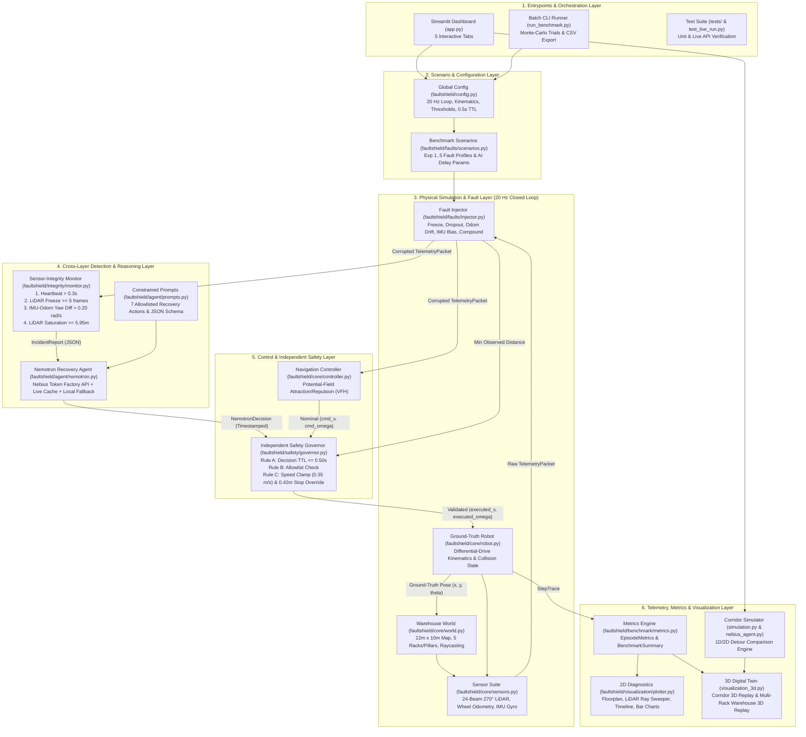
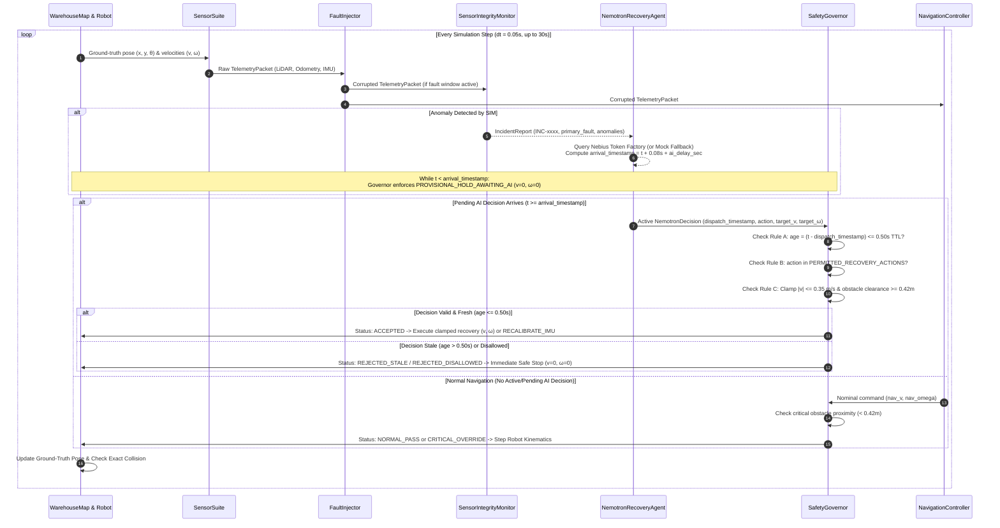
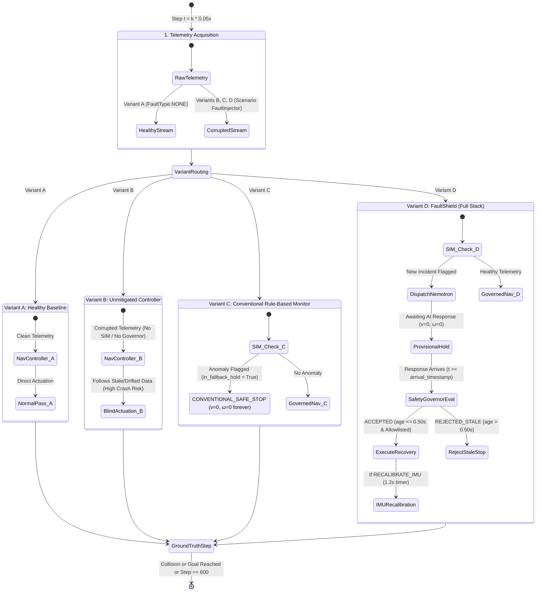

# 🛡️ FaultShield: Complete Project Review & High-Level Workflow Architecture

> **Project Purpose:** Cross-Layer Reliability Benchmark & Recovery Agent for Simulated Autonomous Mobile Robots  
> **Core Stack:** Python 3.12+, NVIDIA Nemotron (`nvidia/nemotron-3-super-120b-a12b`) via Nebius Token Factory (`OpenAI` SDK), NumPy, Pandas, Plotly (2D & 3D `Mesh3d`), Streamlit, Pytest.

---

## 1. High-Level End-to-End System Workflow Architecture

FaultShield is architected around a **layered physical-AI control loop** with an **independent fail-safe governor** and a **dual-engine visualization pipeline** (Multi-Rack Warehouse 2D/3D engine + Corridor 3D replay engine).

---

## 2. Runtime Execution & Recovery Sequence (`Variant_D` Loop)

During each simulation episode (`max_steps = 600`, `dt = 0.05s`), [`BenchmarkRunner.run_episode`](file:///d:/Hackathons/FaultShield%20ChatGPT/faultshield/benchmark/runner.py#L69-L359) orchestrates the interaction between synchronous 20 Hz physical simulation and asynchronous/delayed cloud inference:

---

## 3. Four-Variant Comparative Architecture State Machine

FaultShield benchmarks every fault scenario across four distinct control architectures in [`BenchmarkRunner`](file:///d:/Hackathons/FaultShield%20ChatGPT/faultshield/benchmark/runner.py#L151-L273) to isolate the impact of sensor monitoring, LLM recovery reasoning, and TTL governance:

---

## 4. Dual Simulation & Visualization Pipeline Architecture

A key structural feature of the repository is that [`app.py`](file:///d:/Hackathons/FaultShield%20ChatGPT/app.py#L267-L376) integrates **two complementary simulation pipelines** for visual comparison in Tab 1:

| Pipeline | Core Modules | World Geometry | Action Vocabulary | Primary Role in UI |
| :--- | :--- | :--- | :--- | :--- |
| **1. Multi-Rack Warehouse Engine (Primary)** | [`faultshield/core/*`](file:///d:/Hackathons/FaultShield%20ChatGPT/faultshield/core/world.py), [`runner.py`](file:///d:/Hackathons/FaultShield%20ChatGPT/faultshield/benchmark/runner.py), [`plotter.py`](file:///d:/Hackathons/FaultShield%20ChatGPT/faultshield/visualization/plotter.py), [`build_3d_warehouse_replay`](file:///d:/Hackathons/FaultShield%20ChatGPT/visualization_3d.py#L259-L378) | 12m × 10m room with 4 storage racks (`Rack_A1`, `Rack_A2`, `Rack_B1`, `Rack_B2`) and `Pillar_Center` | 7 actions in [`PERMITTED_RECOVERY_ACTIONS`](file:///d:/Hackathons/FaultShield%20ChatGPT/faultshield/config.py#L48-L56) (`SAFE_STOP_AND_HOLD`, `REVERSE_SLOWLY`, `RECALIBRATE_IMU`, etc.) | Powers all KPI metrics, 4-Variant comparisons, batch Monte-Carlo CSV runs, 2D floorplan + LiDAR scrubber, and the "Multi-Rack Warehouse 3D Digital Twin" mode. |
| **2. Corridor Detour Engine (Secondary Replay)** | [`simulation.py`](file:///d:/Hackathons/FaultShield%20ChatGPT/simulation.py#L35-L221), [`nebius_agent.py`](file:///d:/Hackathons/FaultShield%20ChatGPT/nebius_agent.py#L16-L102), [`build_3d_replay`](file:///d:/Hackathons/FaultShield%20ChatGPT/visualization_3d.py#L151-L256) | 10m straight corridor with a central cylindrical obstacle at `(5.0, 0.0)` ($r = 0.58\text{ m}$) | 4 actions (`BYPASS_LEFT`, `BYPASS_RIGHT`, `SAFE_STOP`, `CONTINUE`) | Powers the "Corridor Obstacle 3D Replay" mode, 2D trajectory status cards, and the side-by-side Event Timeline in Tab 1. |

---

## 5. Complete Codebase Module Inventory

### Core Package (`faultshield/`)
* **[`faultshield/config.py`](file:///d:/Hackathons/FaultShield%20ChatGPT/faultshield/config.py)**: Centralizes simulation timestep (`0.05s`), robot kinematic bounds, sensor noise parameters, SIM anomaly thresholds, Safety Governor limits (`GOVERNOR_MAX_DECISION_TTL_SEC = 0.50s`, `GOVERNOR_CRITICAL_STOP_DISTANCE = 0.42m`), and Nebius Token Factory defaults.
* **[`faultshield/core/world.py`](file:///d:/Hackathons/FaultShield%20ChatGPT/faultshield/core/world.py)**: Implements [`RectObstacle`](file:///d:/Hackathons/FaultShield%20ChatGPT/faultshield/core/world.py#L13-L34) and [`WarehouseMap`](file:///d:/Hackathons/FaultShield%20ChatGPT/faultshield/core/world.py#L37-L153) with parametric ray-segment intersection (`_ray_segment_intersect`) for 24-beam LiDAR simulation and exact circular-robot collision detection.
* **[`faultshield/core/robot.py`](file:///d:/Hackathons/FaultShield%20ChatGPT/faultshield/core/robot.py)**: Implements [`DifferentialDriveRobot`](file:///d:/Hackathons/FaultShield%20ChatGPT/faultshield/core/robot.py#L39-L118) with acceleration-limited midpoint Euler integration and collision immobilization.
* **[`faultshield/core/sensors.py`](file:///d:/Hackathons/FaultShield%20ChatGPT/faultshield/core/sensors.py)**: Implements [`SensorSuite`](file:///d:/Hackathons/FaultShield%20ChatGPT/faultshield/core/sensors.py#L68-L198) producing [`TelemetryPacket`](file:///d:/Hackathons/FaultShield%20ChatGPT/faultshield/core/sensors.py#L59-L66) (`LidarReading`, `OdometryReading`, `IMUReading`) with seeded stochastic Gaussian noise and wheel slip.
* **[`faultshield/core/controller.py`](file:///d:/Hackathons/FaultShield%20ChatGPT/faultshield/core/controller.py)**: Implements [`NavigationController`](file:///d:/Hackathons/FaultShield%20ChatGPT/faultshield/core/controller.py#L19-L105), a reactive potential-field controller combining goal attraction and inverse-square LiDAR obstacle repulsion.
* **[`faultshield/faults/injector.py`](file:///d:/Hackathons/FaultShield%20ChatGPT/faultshield/faults/injector.py)** & **[`scenarios.py`](file:///d:/Hackathons/FaultShield%20ChatGPT/faultshield/faults/scenarios.py)**: Implements [`FaultInjector`](file:///d:/Hackathons/FaultShield%20ChatGPT/faultshield/faults/injector.py#L32-L156) and the 5 standardized [`BENCHMARK_SCENARIOS`](file:///d:/Hackathons/FaultShield%20ChatGPT/faultshield/faults/scenarios.py#L34-L95).
* **[`faultshield/integrity/monitor.py`](file:///d:/Hackathons/FaultShield%20ChatGPT/faultshield/integrity/monitor.py)**: Implements [`SensorIntegrityMonitor`](file:///d:/Hackathons/FaultShield%20ChatGPT/faultshield/integrity/monitor.py#L65-L179), executing deterministic checks on telemetry freshness, consecutive identical LiDAR frames, IMU-vs-Odometry yaw rate divergence, and range saturation.
* **[`faultshield/agent/nemotron.py`](file:///d:/Hackathons/FaultShield%20ChatGPT/faultshield/agent/nemotron.py)** & **[`prompts.py`](file:///d:/Hackathons/FaultShield%20ChatGPT/faultshield/agent/prompts.py)**: Implements [`NemotronRecoveryAgent`](file:///d:/Hackathons/FaultShield%20ChatGPT/faultshield/agent/nemotron.py#L50-L233) with OpenAI-compatible client calls to Nebius Token Factory, regex JSON extraction, per-fault live response caching, and deterministic offline fallback.
* **[`faultshield/safety/governor.py`](file:///d:/Hackathons/FaultShield%20ChatGPT/faultshield/safety/governor.py)**: Implements [`SafetyGovernor`](file:///d:/Hackathons/FaultShield%20ChatGPT/faultshield/safety/governor.py#L32-L135), enforcing TTL expiration, action allowlisting, recovery speed clamping, and critical obstacle proximity overrides.
* **[`faultshield/benchmark/runner.py`](file:///d:/Hackathons/FaultShield%20ChatGPT/faultshield/benchmark/runner.py)** & **[`metrics.py`](file:///d:/Hackathons/FaultShield%20ChatGPT/faultshield/benchmark/metrics.py)**: Implements [`BenchmarkRunner`](file:///d:/Hackathons/FaultShield%20ChatGPT/faultshield/benchmark/runner.py#L62-L359), [`EpisodeMetrics`](file:///d:/Hackathons/FaultShield%20ChatGPT/faultshield/benchmark/metrics.py#L12-L42), and [`compute_benchmark_summary`](file:///d:/Hackathons/FaultShield%20ChatGPT/faultshield/benchmark/metrics.py#L60-L94).
* **[`faultshield/visualization/plotter.py`](file:///d:/Hackathons/FaultShield%20ChatGPT/faultshield/visualization/plotter.py)**: Builds Plotly figures for the 2D warehouse floorplan, scrubbed LiDAR ray fan, telemetry timelines, and 4-variant grouped bar charts.

---

## 6. Key Technical Findings from Project Audit

> [!IMPORTANT]
> During the full code review, we identified three subtle behavioral mechanics in the current implementation that affect benchmark numbers in [`results/benchmark_summary.csv`](file:///d:/Hackathons/FaultShield%20ChatGPT/results/benchmark_summary.csv):

1. **Active AI Decision Aging Across Subsequent Timesteps ([`runner.py` L229-L245](file:///d:/Hackathons/FaultShield%20ChatGPT/faultshield/benchmark/runner.py#L229-L245))**:
   - When an AI decision arrives with a small network delay (e.g., `ai_delay_sec = 0.1s` in `exp2_frozen_lidar`, total latency `0.18s`), the Safety Governor initially approves it (`ACCEPTED`) because `age = 0.18s <= 0.50s`.
   - However, because `active_ai_decision` remains stored while executing continuous actions (like `REVERSE_SLOWLY`), `age = current_sim_time - ai_decision.dispatch_timestamp` increases by `0.05s` on every subsequent simulation step.
   - Seven steps later (`0.35s` after arrival), `age` exceeds `0.50s`, causing the Governor to mark the already-accepted ongoing maneuver as `REJECTED_STALE`, clear `active_ai_decision`, and re-query Nemotron on the next tick. This explains why `exp2_frozen_lidar` logs `26` stale rejections even though its network delay is only `0.1s`.

2. **Reactive Potential-Field Local Minima in Warehouse Layout ([`controller.py` L68-L95](file:///d:/Hackathons/FaultShield%20ChatGPT/faultshield/core/controller.py#L68-L95))**:
   - In [`results/benchmark_summary.csv`](file:///d:/Hackathons/FaultShield%20ChatGPT/results/benchmark_summary.csv#L2-L5), `Goal Completion (%)` is `0.0%` even in `exp1_healthy` (`Mean Duration = 30.0s`, `Path Length = 8.74m`).
   - Why? The robot starts at `(1.5, 1.5)` aiming for `(10.5, 8.5)`, and the potential-field repulsion from `Rack_A1`, `Rack_A2`, and `Pillar_Center` balances the attractive force or causes slow contouring that does not reach within `0.5m` of `(10.5, 8.5)` before the 600-step (`30s`) limit expires.

3. **Action Set Mapping Between Warehouse Engine and Corridor 3D Engine ([`app.py` L285-L291](file:///d:/Hackathons/FaultShield%20ChatGPT/app.py#L285-L291))**:
   - [`NemotronRecoveryAgent`](file:///d:/Hackathons/FaultShield%20ChatGPT/faultshield/agent/nemotron.py) outputs one of the 7 warehouse actions (e.g., `REVERSE_SLOWLY`, `RECALIBRATE_IMU`, `SAFE_STOP_AND_HOLD`), whereas [`simulation.py`](file:///d:/Hackathons/FaultShield%20ChatGPT/simulation.py) expects one of 4 corridor actions (`BYPASS_LEFT`, `BYPASS_RIGHT`, `SAFE_STOP`, `CONTINUE`). Currently, [`app.py`](file:///d:/Hackathons/FaultShield%20ChatGPT/app.py#L285-L291) maps `SAFE_STOP_AND_HOLD -> SAFE_STOP` and defaults all other warehouse actions to `BYPASS_LEFT` for the corridor 3D view.
